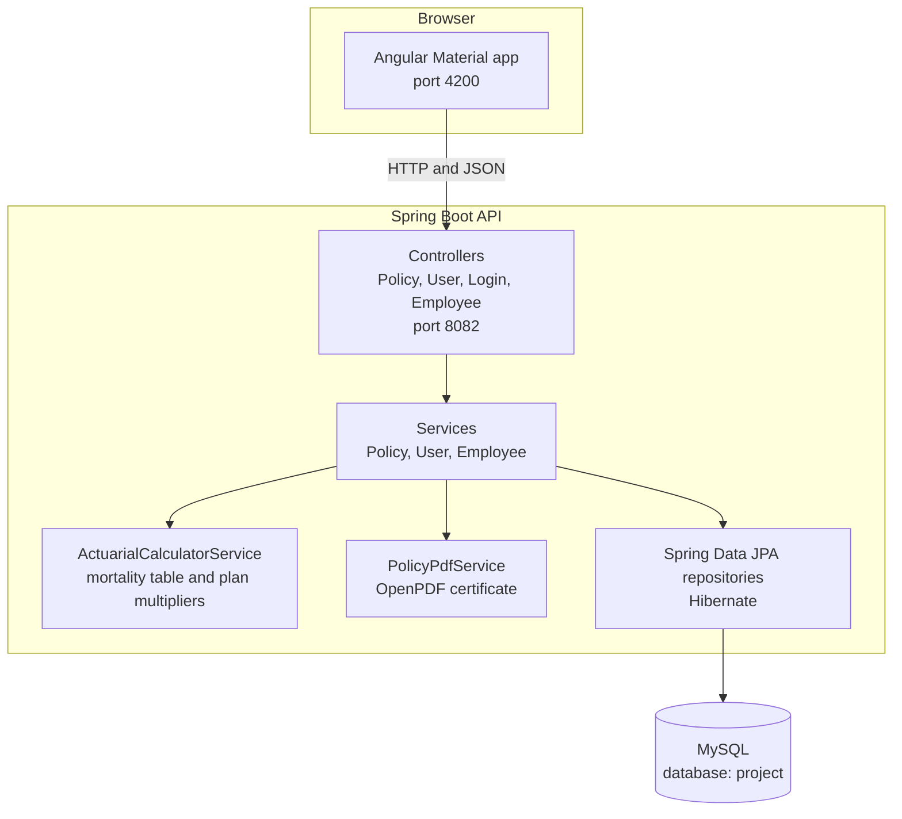

# Insurance Management System


A full stack web application for managing insurance policies. You can create and edit policies, calculate premiums for four coverage plans, move claims through a review workflow, and download a policy certificate as a PDF. The server is built with Spring Boot, Spring Data JPA and MySQL, and the user interface is an Angular Material app.

## Quick start

The Angular app is already compiled and stored in `frontend/dist`, so you do not need Node.js or the Angular CLI to run the project.

1. Install the tools listed under [Requirements](#requirements).
2. Create the database (see [Database setup](#database-setup)).
3. Set your MySQL password in `backend/src/main/resources/application.properties`.
4. Run the project:

```bash
git clone https://github.com/Vikas1267/Insurance-Management-System.git
cd Insurance-Management-System
python run.py
```

`npm start` does the same thing. The script starts the Spring Boot API on port 8082 and the web app on port 4200. Press `Ctrl + C` in the terminal to stop both.

Open <http://localhost:4200> and sign in with the demo account:

| Field | Value |
| :--- | :--- |
| Email | `indlavikas57@gmail.com` |
| Password | `12345678` |

This account comes from the sample data in `database/schema.sql` and is meant for local use only.

## What you can try

After you sign in, these are good places to start:

- **Policies:** add, edit, view and delete policies on the portfolio page.
- **Premium calculator:** enter an age, sum assured, term in years, coverage plan and smoker status, then compare the annual and monthly premium across plans.
- **Claims:** open a sample claim (`CLM-502`, `CLM-104` or `CLM-311`) and move it through review, settlement or rejection.
- **Policy certificate:** download any policy as a PDF.
- **CSV export:** download all policies as a CSV file.
- **Dashboard:** see totals for policies, sum assured, premium income and settlement ratio.

## Screenshots

### Dashboard

![Dashboard with portfolio totals, premium calculator and claim workflow]


*Portfolio totals, the premium calculator and the claim workflow on one page. The figures come from the sample policies in `schema.sql`.*

### Policy list

![Policy list with search, add, edit, delete and PDF download]

*Search, add, edit and delete policies, and download a policy PDF from each row.*

### Policy portfolio and certificates

![Policy portfolio table with coverage plan, claim status and PDF download]

*Each policy shows its coverage plan, sum assured, premium and claim status, with a button for the PDF certificate and a CSV export.*

### Premium calculator

![Premium calculator with age, plan, sum assured, term and smoker options]

*Enter an age, plan, sum assured, term and smoker status to get the annual premium and the semi-annual, quarterly and monthly amounts.*

### Claims workflow

![Claims page with status filters and review, settle and decline actions]

*Filter claims by status and move each one to review, settlement or rejection.*

### Database

![Policy and claim records in MySQL Workbench]


*Policy and claim records in MySQL Workbench, showing claim numbers and the `UNDER_REVIEW`, `SETTLED` and `REJECTED` states.*

## Features

**Premium calculation.** The annual and monthly premium depends on the applicant's age, the policy term, whether the applicant smokes, and a mortality rate table. Each coverage plan applies its own multiplier to the base premium. The calculator shows the annual premium and the semi-annual, quarterly and monthly amounts:

| Coverage plan | Multiplier |
| :--- | :--- |
| Pure Term Life Assurance | 1.0x |
| Whole Life Comprehensive Protection | 1.75x |
| Endowment with Guaranteed Savings | 2.2x |
| Term Life with Critical Illness Rider | 1.4x |

**Claim workflow.** A claim moves from `SUBMITTED` to `UNDER_REVIEW`, and then to `SETTLED` or `REJECTED`. Each decision carries a remark that is saved with the claim.

**PDF policy certificate.** `GET /policy/export/pdf/{id}` builds a certificate with OpenPDF. It contains the policy schedule, the coverage benefits, a disclaimer and a signature block.

**CSV export.** `GET /policy/export/csv` returns every policy as a CSV file.

**Data model.** Users, employees, addresses (`@OneToMany`) and policies are stored with Spring Data JPA and Hibernate.

## Architecture

The server follows a Controller, Service, Repository layout.



## Tech stack

| Area | Technology |
| :--- | :--- |
| API | Java 21, Spring Boot (exact version in `backend/pom.xml`) |
| Persistence | Spring Data JPA, Hibernate |
| Database | MySQL 8.0 or later |
| PDF | OpenPDF |
| Web app | Angular, Angular Material, TypeScript, SCSS |
| Tests | JUnit, Mockito |
| Build and run | Maven, Python runner script (`run.py`) |

## Requirements

| Tool | Version | Used for |
| :--- | :--- | :--- |
| Java (JDK) | 21 (8, 11 and 17 also work) | Spring Boot API |
| Maven | 3.6 or later, or the bundled `mvnw` | Building the API |
| MySQL | 8.0, 8.4 or 9.x | Database |
| Python | 3.8 or later | `run.py` and the web server |
| Node.js | 16 or later, only to change the Angular source | Rebuilding `frontend/dist` |

## Database setup

The file `database/schema.sql` creates the schema and the sample data.

```bash
mysql -u root -p < database/schema.sql
```

You can also open the file in MySQL Workbench and run it there. The script:

- creates the `project` database,
- creates the tables `policy`, `user`, `emps`, `emps_address` and `address`,
- adds five sample policies with claims (`CLM-502`, `CLM-104`, `CLM-311` and others),
- adds the demo user account shown in [Quick start](#quick-start).

Then open `backend/src/main/resources/application.properties` and set your own MySQL password:

```properties
server.port=8082

spring.datasource.url=jdbc:mysql://localhost:3306/project?autoReconnect=true&useSSL=false&allowPublicKeyRetrieval=true&serverTimezone=UTC
spring.datasource.username=root
spring.datasource.password=YOUR_MYSQL_PASSWORD
spring.datasource.driver-class-name=com.mysql.cj.jdbc.Driver

spring.jpa.hibernate.ddl-auto=update
spring.jpa.show-sql=true
spring.jpa.properties.hibernate.dialect=org.hibernate.dialect.MySQL8Dialect
```

If MySQL runs on another port, such as 3307, change the port in `spring.datasource.url`.

## API reference

| Method | Endpoint | Description | Body or parameters |
| :--- | :--- | :--- | :--- |
| `POST` | `/login` | Sign in | `{"username": "...", "userpwd": "..."}` |
| `GET` | `/policy/getAll` | List all policies | none |
| `POST` | `/policy/save` | Create or update a policy | `Policy` JSON |
| `GET` | `/policy/get/{id}` | Get one policy | path variable `id` |
| `DELETE` | `/policy/delete/{id}` | Delete a policy | path variable `id` |
| `GET` | `/policy/export/pdf/{id}` | Download the policy certificate (PDF) | path variable `id` |
| `POST` | `/policy/calculate-premium` | Calculate a premium | `{ age, sumAssured, termYears, coverageType, isSmoker }` |
| `POST` | `/policy/claim/adjudicate` | Update the status of a claim | `{ policyId, claimStatus, claimRemarks }` |
| `GET` | `/policy/dashboard/metrics` | Dashboard totals and settlement ratio | none |
| `GET` | `/policy/export/csv` | Download all policies as CSV | none |
| `POST` | `/user/save` | Register a user | `User` JSON |
| `GET` | `/user/getcity/{city}` | List users in a city | path variable `city` |
| `POST` | `/employee/saveEmpAdd` | Save an employee with addresses | `Employee` JSON |

## Run the parts separately

Use this if you prefer two terminals instead of `python run.py`.

Start the API (runs at <http://localhost:8082>):

```bash
cd backend
mvn spring-boot:run
```

Start the web app (runs at <http://localhost:4200>):

```bash
cd frontend
python serve_spa.py
```

## Run the tests

```bash
cd backend
mvn test
```

## Rebuild the Angular app

Only needed if you change the code in `frontend/src/`.

```bash
cd frontend
npm install
npm run build
```

On Node 17 or later, set the legacy OpenSSL option first. In PowerShell:

```powershell
$env:NODE_OPTIONS="--openssl-legacy-provider"; npm run build
```

On Linux or macOS:

```bash
export NODE_OPTIONS="--openssl-legacy-provider" && npm run build
```

## Author

**Omvikas Indla**, Java Full Stack Developer

B.Tech in Computer Science, DY Patil University, Pune

- Email: [indlavikas57@gmail.com](mailto:indlavikas57@gmail.com)
- GitHub: [github.com/Vikas1267](https://github.com/Vikas1267)

## License

Released under the MIT License. See the [LICENSE](LICENSE) file.
