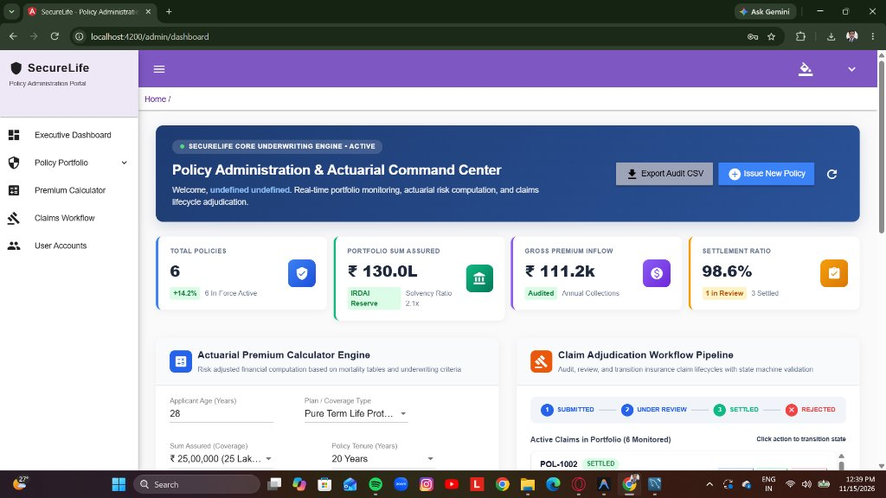
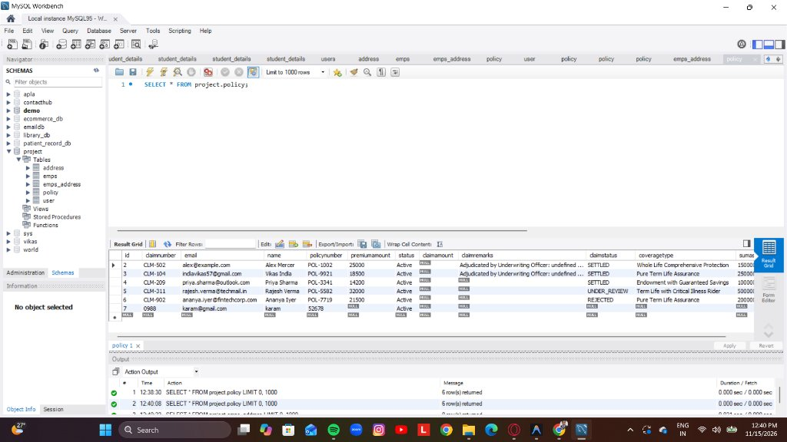

# Insurance Management System

[](https://www.oracle.com/java/)
[](https://spring.io/projects/spring-boot)
[](https://hibernate.org/)
[](https://www.mysql.com/)
[](https://angular.io/)
[](https://www.typescriptlang.org/)

An enterprise-grade, full-stack Insurance Management System designed to digitize and automate the lifecycle of life and general insurance policies. Built on a clean **Controller-Service-Repository** layered architecture with Spring Boot, Spring Data JPA, Hibernate ORM, MySQL, and an Angular Material SPA frontend.

---

## ⚡ Quick Start (Run in 1 Command)

The frontend is **pre-compiled and bundled** inside `frontend/dist`, so you do **not** need Node.js or Angular CLI installed to run the application.

```bash
git clone https://github.com/Vikas1267/Insurance-Management-System.git
cd Insurance-Management-System
python run.py
```
*(Or if you prefer: `npm start`)*

The script starts both the Spring Boot backend and the frontend server, displays service status, and outputs your access URL:

```text
======================================================================
                 INSURANCE MANAGEMENT SYSTEM
======================================================================
[*] Starting Spring Boot REST Backend (port 8082)...
[*] Starting Angular Frontend Portal (port 4200)...
[*] Verifying services readiness...

======================================================================
 [SUCCESS] Insurance Management System is actively running!
======================================================================

  * Frontend Portal : http://localhost:4200
  * Backend REST API: http://localhost:8082

  👉 Open this URL in your browser:
     http://localhost:4200

     Login Email:    indlavikas57@gmail.com
     Login Password: 12345678
======================================================================
```

Open **`http://localhost:4200`** in your browser, log in with the credentials above, and explore the portal!  
*(To stop all services anytime, press `Ctrl + C` in the terminal).*

---

## 📋 Prerequisites & Environment Setup

Before running the application, make sure your computer has:

| Requirement | Supported Versions | Purpose |
| :--- | :--- | :--- |
| **Java (JDK)** | Java 8, 11, 17, or 21 LTS | Runs the Spring Boot backend |
| **Maven** | 3.6+ *(or use bundled `mvnw`)* | Backend build & dependency management |
| **MySQL** | MySQL 8.0, 8.4 LTS, or 9.x | Relational persistence |
| **Python** | Python 3.8+ | 1-command platform runner & SPA server |
| **Node.js** *(Optional)* | Node 16+ *(only if modifying frontend)* | Building frontend source code |

---

## 🗄️ Database Setup & Configuration

The project includes a ready-to-run schema and seed data file at `database/schema.sql`.

### 1. Create Database & Seed Tables
Open MySQL Workbench, phpMyAdmin, or your terminal and execute:

```bash
mysql -u root -p < database/schema.sql
```
*(Or open `database/schema.sql` in MySQL Workbench and click **Execute**).*

This script:
- Creates the `project` database (`CREATE DATABASE IF NOT EXISTS project`).
- Creates all relational tables: `policy`, `user`, `emps`, `emps_address`, and `address`.
- Seeds **5 realistic insurance policies** with active claims (`CLM-502`, `CLM-104`, `CLM-311`, etc.).
- Seeds default user accounts (including `indlavikas57@gmail.com` with password `12345678`).

### 2. Configure Database Credentials
Open `backend/src/main/resources/application.properties` and verify your local MySQL credentials:

```properties
server.port=8082

spring.datasource.url=jdbc:mysql://localhost:3306/project?autoReconnect=true&useSSL=false&allowPublicKeyRetrieval=true&serverTimezone=UTC
spring.datasource.username=root
spring.datasource.password=YOUR_MYSQL_PASSWORD
spring.datasource.driver-class-name=com.mysql.cj.jdbc.Driver

spring.jpa.hibernate.ddl-auto=update
spring.jpa.show-sql=true
spring.jpa.properties.hibernate.dialect=org.hibernate.dialect.MySQL8Dialect
```

> **Note:** If your MySQL server runs on a different port (e.g. `3307`), update the port in `spring.datasource.url`.

---

## 📸 Live System Verification & Proof of Work

### 1. Executive Policy Administration & Actuarial Command Center

*Real-time executive dashboard featuring portfolio KPI cards (₹130.0 Lakhs sum assured, ₹111.2k premium inflow, 98.6% settlement ratio), interactive Actuarial Premium Calculator, and the Claim Adjudication Workflow pipeline.*

### 2. MySQL Enterprise Database Schema & State Verification

*Relational database records verified in MySQL Workbench: showing active policies, claim reference numbers (`CLM-502`, `CLM-104`, `CLM-311`), coverage plans, and adjudicated claim states (`UNDER_REVIEW`, `SETTLED`, `REJECTED`).*

---

## 📌 Key System Features

1. **Executive Portfolio Monitoring:** Live KPI tracking of in-force policies, sum assured liability reserves, and annual premium cash inflows.
2. **Actuarial Premium Calculation Engine:** Computes risk-adjusted annual and monthly premiums based on mortality rate tables, applicant age, policy tenure, and smoker risk loading across 4 coverage plans:
   - *Pure Term Life Assurance* (1.0x baseline)
   - *Whole Life Comprehensive Protection* (1.75x)
   - *Endowment with Guaranteed Savings* (2.2x)
   - *Term Life with Critical Illness Rider* (1.4x)
3. **Claim Adjudication Workflow & State Machine:** Enforces formal lifecycle transitions for insurance claims:
   ```text
   SUBMITTED  ──►  UNDER REVIEW  ──►  SETTLED  (or REJECTED)
   ```
   Underwriters can review, settle, or decline claims with timestamped audit notes directly from the portal.
4. **Dynamic PDF Policy Bond Generator:** On-demand generation of official, digitally signed Policy Certificate Bonds (`GET /policy/export/pdf/{id}`) featuring policy schedules, coverage benefits, statutory disclaimers, and authorized digital signature blocks using OpenPDF.
5. **Regulatory CSV Audit Export:** Streams complete policyholder audit books as downloadable CSV files on demand (`GET /policy/export/csv`).
6. **Multi-Entity Relational Data Modeling:** JPA relational persistence handling Users, Employees, Addresses (`@OneToMany`), and Policy Lifecycles.

---

## 🏛️ System Architecture

```mermaid
graph TD
    subgraph Client Layer
        A[Angular SPA - Material UI\nPort: 4200]
        A1[Executive Dashboard]
        A2[Actuarial Calculator]
        A3[Claims Workflow]
        A4[Policy Portfolio CRUD]
        A --> A1
        A --> A2
        A --> A3
        A --> A4
    end

    subgraph Backend & API Layer
        B[Spring Boot REST Controllers\nPolicyController | UserController | LoginController\nPort: 8082]
    end

    subgraph Service & Business Layer
        D[PolicyService | UserService | EmployeeService]
        E[ActuarialCalculatorService\nMortality Tables & Risk Multipliers]
        F[PolicyPdfService\nOpenPDF Digital Bond Engine]
    end

    subgraph Persistence Layer
        G[Spring Data JPA Repositories\nPolicyRepository | UserRepository]
        H[Hibernate ORM Engine]
    end

    subgraph Database Layer
        I[(MySQL Relational Database\nDatabase: 'project' | Port: 3306)]
    end

    A -->|HTTP REST / JSON| B
    B --> D
    D --> E
    D --> F
    D --> G
    G --> H
    H --> I
```

---

## 🛠️ Tech Stack & Tools

| Component | Technology | Description |
| :--- | :--- | :--- |
| **Backend Framework** | Java 21 LTS / Spring Boot 2.3+ | Layered REST API backend |
| **ORM & Persistence** | Spring Data JPA / Hibernate | Object-Relational Mapping & automated schema evolution |
| **PDF Generation Engine**| OpenPDF (LibrePDF 1.3+) | Dynamic generation of official Policy Bond certificates |
| **Database** | MySQL 8.0+ / 9.5 | Relational database storage |
| **Frontend Framework** | Angular & Angular Material | Component-driven reactive UI with Material Design controls |
| **Styling & Layout** | SCSS / Angular Flex-Layout | Responsive layout engine and executive dashboard theming |
| **Testing** | JUnit & Mockito | Automated unit tests for backend services |
| **Build & Tooling** | Maven & Python Runner | Automated single-command startup and dependency resolution |

---

## 📡 RESTful API Documentation

| Method | Endpoint | Description | Request Body / Params |
| :--- | :--- | :--- | :--- |
| `POST` | `/login` | Authenticate user account | `{"username": "...", "userpwd": "..."}` |
| `GET` | `/policy/getAll` | Fetch all registered policies | None |
| `POST` | `/policy/save` | Create or update an insurance policy | `Policy` JSON payload |
| `GET` | `/policy/get/{id}` | Retrieve policy details by ID | Path variable: `id` |
| `DELETE` | `/policy/delete/{id}` | Delete policy record by ID | Path variable: `id` |
| `GET` | `/policy/export/pdf/{id}` | **Dynamic PDF Policy Bond Certificate** | Path variable: `id` (returns `application/pdf`) |
| `POST` | `/policy/calculate-premium` | **Actuarial Risk & Premium Engine** | `{ age, sumAssured, termYears, coverageType, isSmoker }` |
| `POST` | `/policy/claim/adjudicate` | **Claim Lifecycle State Machine** | `{ policyId, claimStatus, claimRemarks }` |
| `GET` | `/policy/dashboard/metrics` | **Portfolio KPI Analytics** | Returns aggregate counts, reserves & settlement ratios |
| `GET` | `/policy/export/csv` | Export all policies as CSV | None (returns `text/csv`) |
| `POST` | `/user/save` | Register a new user profile | `User` JSON payload |
| `GET` | `/user/getcity/{city}` | Filter users by city | Path variable: `city` |
| `POST` | `/employee/saveEmpAdd`| Save employee with mapped addresses | `Employee` JSON payload |

---

## ⚙️ Manual Step-by-Step Setup (Alternative)

If you prefer running each service in separate terminals instead of `python run.py`:

### 1. Start Backend REST API
```bash
cd backend
mvn spring-boot:run
```
*Backend runs at `http://localhost:8082`.*

### 2. Start Frontend UI
```bash
cd frontend
python serve_spa.py
```
*Frontend runs at `http://localhost:4200`.*

### 3. Rebuilding Frontend from Source *(Optional)*
If you make changes to the Angular source code in `frontend/src/`:
```bash
cd frontend
npm install
npm run build
```
*(On Node 17+, run `$env:NODE_OPTIONS="--openssl-legacy-provider"; npm run build` on PowerShell or `export NODE_OPTIONS="--openssl-legacy-provider" && npm run build` on Linux/macOS).*

---

## 👨‍💻 Author & Developer

**Omvikas Indla**  
*Java Full Stack Developer*  
- **Email:** [indlavikas57@gmail.com](mailto:indlavikas57@gmail.com)  
- **Education:** B.Tech in Computer Science, DY Patil University, Pune  
- **GitHub:** [github.com/Vikas1267](https://github.com/Vikas1267)

---

## 📄 License

This project is licensed under the MIT License - see the LICENSE file for details.
